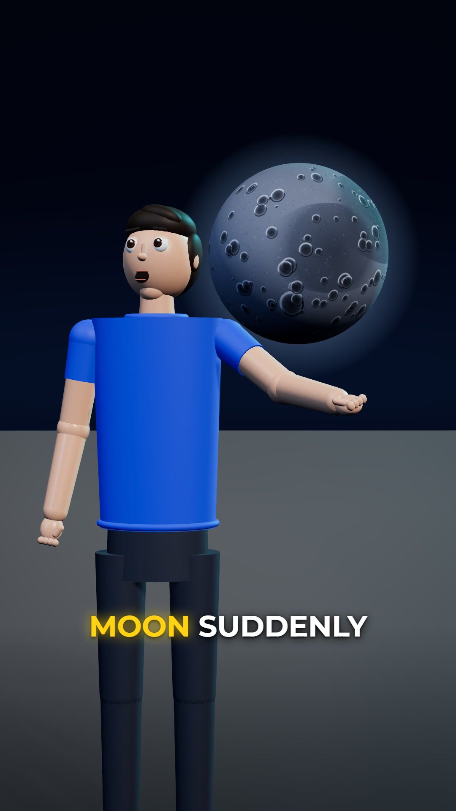
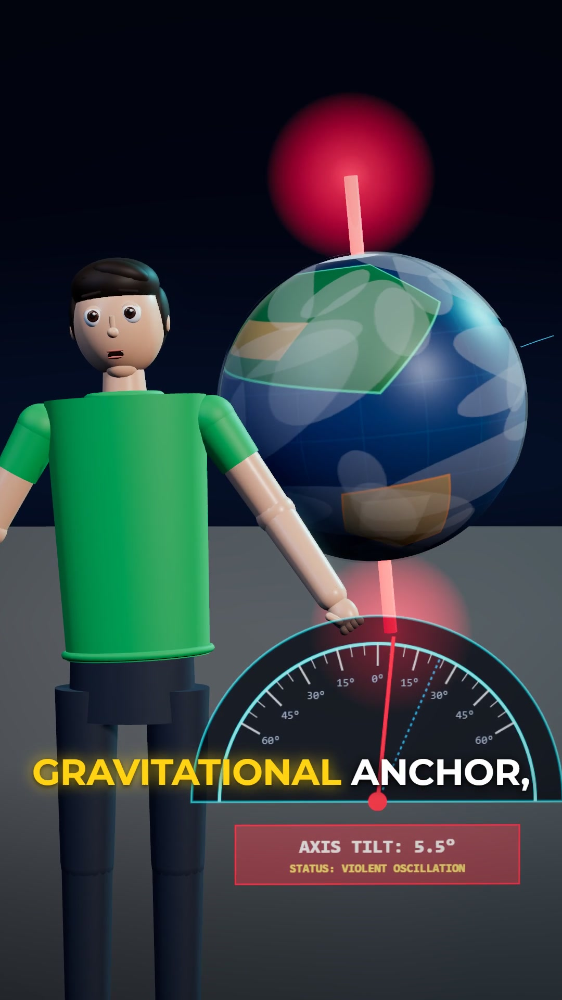
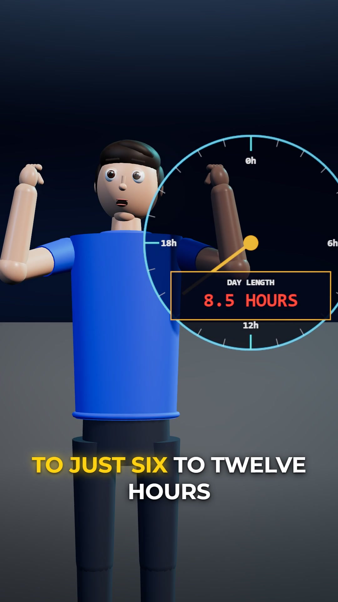
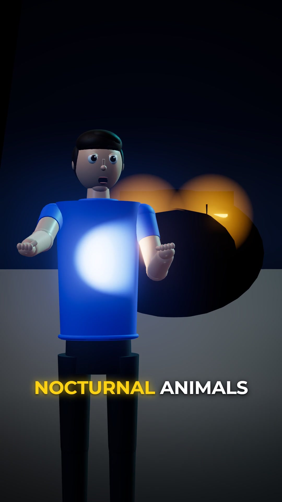

# 🎬 Animation Skills Suite & Vertical Shorts Engine

> Studio-grade procedural animation skills, 3D WebGL explainer rendering, kinetic typography, and vertical short-form video generation for AI coding agents (Antigravity, Claude, Cursor).

<p align="center">
  
  
  
  
</p>

<p align="center">
  <a href="https://opensource.org/licenses/MIT"></a>
  <a href="#"></a>
  <a href="#"></a>
  <a href="#"></a>
  <a href="#"></a>
</p>

---

## 📸 Visual Showcase & Scene Architecture

| Shot 1: The Vanishing Hook | Shot 2: Gravitational Wobble | Shot 3: Supersonic Equator Spin | Shot 4: Nocturnal Void |
|:---:|:---:|:---:|:---:|
|  |  |  |  |
| **Hero Acting & Moon** | **Live Protractor HUD** | **Speedometer Countdown** | **Flashlight & Predator Eyes** |
| Dual-framed waist-up character with particle shockwaves. | 3D Earth globe with live tilt angle gauge ($10^\circ \leftrightarrow 45^\circ$). | Rapid day/night strobe lighting and 24h to 6h clock transition. | Dynamic spotlight illumination with responsive cartoon pupils. |

---

## 🚀 Key Capabilities

- **8 Studio Animation Skills**: Complete collection of prompt-driven animation skills covering 3D explainers, kinetic stick figures, Notion motion graphics, exploded views, interactive maps, and animated data visualizations.
- **Dual-Framing 3D WebGL Engine**: Native Three.js 9:16 vertical stage with athletic character rigging, procedural facial expressions (blinks, mouth phonemes, brow tension), dynamic camera tracking, and custom GLSL shaders.
- **Deterministic Headless Capturer**: Playwright Chromium integration piping raw WebGL frames directly into FFmpeg at 30 fps CFR with zero frame drops or tearing.
- **Broadcast Audio Multiplexer**: Integrated Gemini TTS narration with -14 LUFS loudness normalization and 48kHz AAC resampling.
- **Kinetic Gold Subtitles**: Word-by-word synchronized keyword-highlighted typography with drop-shadow glow and animated emphasis.

---

## 📦 Skills Catalog

| Skill Name | Description | Output Style |
|---|---|---|
| **`zach-d-films`** | 3D procedural cartoon "What If" explainers | Procedural characters, physics impacts, studio lighting |
| **`stick-figure`** | Kinetic stick-figure explainer reels | Expressive stick people, whip transitions, SFX sync |
| **`notion-video`** | Notion-style aesthetic motion graphics | Roman Muradov vector art, interactive UI cards, checklists |
| **`minimalistic-graphics`** | Clean B&W line-art animation | Monochrome steps, smooth orbits, calm typography |
| **`breakdown`** | 3D exploded-view device teardowns | Floating layers, leader lines, holographic labels |
| **`graph`** | Animated growth charts & counter stats | Smooth drawn line graphs, dynamic stat counters |
| **`map-route`** | 3D journey and commute animations | Procedural white city, drawn route, bouncing pin |
| **`nyt-animation`** | Indian comedic 2D puppet animation | 5-beat escalation, Hinglish voice energy, snap zooms |

---

## 🛠️ Quickstart

### 1. Installation
Clone the repository into your agent's skills directory:

```bash
git clone https://github.com/atharvabalujadhav21052007-ux/animation-skills.git
```

### 2. Antigravity / Claude Integration
Add the desired skill path to your AI agent configuration (e.g. `~/.gemini/config/skills` or `.claude/skills`). Each skill includes a self-contained `SKILL.md` instruction file that instructs the agent on scene design, cinematography, and animation rules.

### 3. Rendering a Master Vertical Reel

```bash
cd engine
pip install playwright
playwright install chromium
python render_reel.py
```

---

## 📐 Architecture

```
animation-skills/
├── docs/images/               # Showcase frames & visual documentation
├── skills/
│   ├── zach-d-films/          # 3D procedural explainer skill
│   ├── stick-figure/          # Stick-figure animation skill
│   ├── notion-video/          # Notion aesthetic motion graphics
│   ├── minimalistic-graphics/  # Line-art minimalist visuals
│   ├── breakdown/             # 3D exploded-view teardowns
│   ├── graph/                 # Line-chart stat animations
│   ├── map-route/             # 3D journey route tracking
│   └── nyt-animation/         # 2D comedic puppet animation
└── engine/
    ├── three_d_web/           # Three.js 9:16 vertical WebGL stage
    │   ├── src/               # Character rigging, materials, shaders, shots
    │   └── index.html         # WebGL canvas with Montserrat typography
    ├── stick_web/             # Canvas2D kinetic stick-figure engine
    ├── generate_3d_scene.py   # Automated 3D scene assembler
    ├── generate_audio_batch.py # Gemini TTS batch narrator
    ├── render_reel.py         # Headless Chromium GPU frame capturer & FFmpeg muxer
    └── verify_reel.py         # Automated adversarial motion & sync verifier
```

---

## 📄 License

MIT © [Atharva Jadhav](https://github.com/atharvabalujadhav21052007-ux)
